# PrimeSkill — System Diagrams

เอกสารนี้ยึดลำดับหัวข้อและภาพรวมจากบทที่ 3 ของรายงาน PrimeSkill CP353002 แล้วตรวจชื่อคลาส/พฤติกรรม/คอลัมน์กับ source ใน `main` ณ `0946ea9` และ `code/src/main/resources/schema.sql`. Deployment Diagram แสดง topology Vercel + Spring Session JDBC + Supabase ตามรายงาน; สถานะการ deploy จริงให้ตรวจจาก [deployment runbook](../vercel-deployment-runbook.md).

## 1. Use Case Diagram

`Owner` คือสมาชิกที่เป็นเจ้าของ Tool ไม่ใช่ role แยกในตารางผู้ใช้ ส่วน `Admin` คือผู้ใช้ที่มี role `ADMIN`.

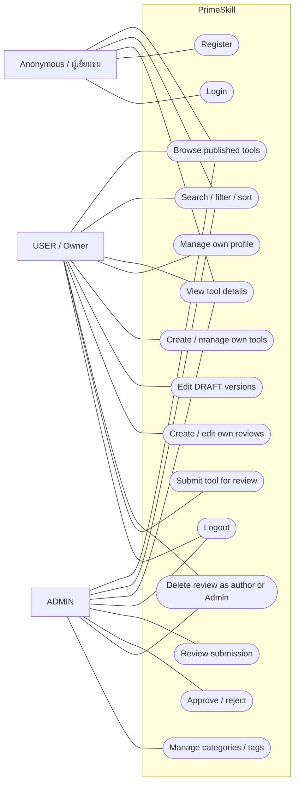

### Use Case Descriptions

| ID / Use case | ผู้เกี่ยวข้องและเงื่อนไขก่อนเริ่ม | Main flow | ทางเลือก/ข้อจำกัด |
|---|---|---|---|
| UC-01 ค้นหาและดู Tool | ผู้เยี่ยมชมหรือสมาชิก; ไม่ต้องเข้าสู่ระบบ | เปิด Browse → ใส่ keyword/category/tag และ sort → ระบบแสดงเฉพาะ Tool สถานะ `PUBLISHED` → เปิดดูรายละเอียด | sort ที่ไม่รองรับ fallback เป็น newest; Tool ที่ไม่เผยแพร่แสดงให้เจ้าของหรือ Admin ตามสิทธิ์เท่านั้น |
| UC-02 สมัคร/เข้าสู่ระบบ/ออกจากระบบ | ผู้เยี่ยมชม (สมัคร/เข้าสู่ระบบ); สมาชิกหรือ Admin (ออกจากระบบ) | สมัครด้วยข้อมูลที่ผ่าน validation หรือส่ง email/password เพื่อ login → ระบบตรวจบัญชีและรหัสผ่าน → สร้าง session; ผู้ใช้ที่เข้าสู่ระบบเลือก Logout เพื่อยกเลิก session | email ซ้ำหรือข้อมูลผิดถูกปฏิเสธ; mutation ที่ใช้ session ต้องมี CSRF token; logout ทำให้ session ใช้ต่อไม่ได้; Admin ใช้ Browse/Search/ดูรายละเอียดได้เช่นเดียวกับผู้เยี่ยมชมและสมาชิก |
| UC-03 จัดการ Tool/เวอร์ชันของตน | USER ที่เป็นเจ้าของ Tool | สร้าง Tool เป็น `DRAFT` → แก้รายละเอียด → จัดการ version/tag ตามสิทธิ์ → ดูรายการของตน | การแก้ metadata, versions และ tags จำกัดที่ `DRAFT`; ผู้ไม่มีสิทธิ์ถูกปฏิเสธ; Tool ที่ไม่เผยแพร่ไม่เปิดเผยต่อผู้ใช้ทั่วไป |
| UC-04 ส่ง Tool เข้าตรวจ | เจ้าของ Tool; Tool อยู่ `DRAFT` | กด Submit → ระบบล็อกแถว Tool, ตรวจสิทธิ์และ transition → เพิ่ม submission revision → เปลี่ยนเป็น `PENDING` | สถานะอื่นส่งไม่ได้; ถ้า transition ไม่ถูกต้องจะได้ conflict; revision ใช้ตรวจคำตัดสินเก่าของ Admin |
| UC-05 ตรวจคำขอเผยแพร่ | Admin; Tool อยู่ `PENDING` | เปิดคิว pending → ตรวจข้อมูล → ส่ง Approve หรือ Reject พร้อม revision ที่ตรวจ → ระบบตรวจสิทธิ์, lock/refresh, ตรวจ revision แล้วเปลี่ยนสถานะ | revision ไม่ตรงถือว่า stale และไม่ใช้คำตัดสิน; Approve → `PUBLISHED`, Reject → `DRAFT` |
| UC-06a สร้างรีวิว | USER ที่เข้าสู่ระบบ; Tool มองเห็นได้และเป็น `PUBLISHED`; ผู้รีวิวไม่ใช่เจ้าของ Tool | ส่งคะแนน 1–5 และ comment → ระบบตรวจสถานะ เจ้าของ และรีวิวเดิม → บันทึกรีวิว | ผู้ใช้หนึ่งคนมีรีวิวต่อ Tool ได้หนึ่งรายการ; เจ้าของ Tool รีวิว Tool ตัวเองไม่ได้ |
| UC-06b แก้ไขรีวิว | ผู้เขียนรีวิวนั้นเข้าสู่ระบบ; Tool มองเห็นได้และเป็น `PUBLISHED` | ส่งคะแนน/comment ใหม่ → ระบบตรวจสถานะและผู้เขียน → บันทึกการแก้ไข | แก้ได้เฉพาะรีวิวของตน; Admin ที่ไม่ใช่ผู้เขียนแก้แทนไม่ได้ |
| UC-06c ลบรีวิว | ผู้ใช้เข้าสู่ระบบ; รีวิวที่ระบุเป็นของ Tool ที่ระบุ | ส่งคำขอลบ → ระบบตรวจว่าเป็นผู้เขียนหรือ Admin → ลบรีวิว | ผู้เขียนหรือ Admin ลบได้; service ปัจจุบันไม่ได้กำหนดเงื่อนไข Tool ต้องเป็น `PUBLISHED` สำหรับการลบ |
| UC-07 จัดการข้อมูลอ้างอิง | Admin | สร้าง/แก้ไข/ลบ Category หรือ Tag ผ่านหน้าหรือ API | ปฏิเสธชื่อ/slug ซ้ำ; ลบข้อมูลที่ยังถูกอ้างอิงไม่ได้ |

## 2. Domain Model / Conceptual Class Diagram

แผนภาพนี้เน้นแนวคิดและความสัมพันธ์ ไม่ใช่รายละเอียดตารางหรือ Spring implementation.

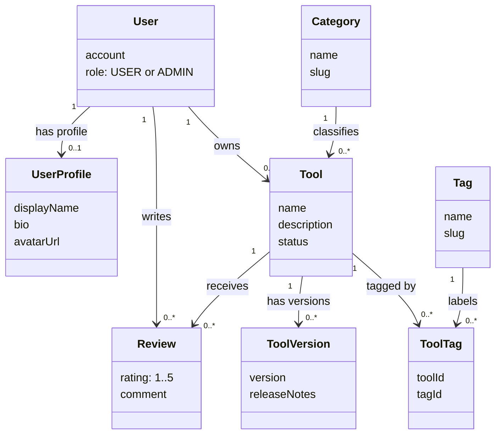

ข้อกำหนดเชิงแนวคิด: `Tool` หนึ่งรายการมี Category หนึ่งรายการ; Tool และ Tag เป็น many-to-many ผ่าน `ToolTag`; ผู้ใช้หนึ่งคนมี Review ได้ไม่เกินหนึ่งรายการต่อ Tool; เจ้าของ Tool เป็น User คนหนึ่ง และ ownership เป็นความสัมพันธ์ของข้อมูล ไม่ใช่ role เพิ่มเติม

## 3. Class Diagram — Design Patterns

แสดงคลาสหลักตามชั้นและจุดที่ใช้ pattern; แผนภาพย่อยของ Layered/MVC, Strategy, State และ Observer อยู่ในหัวข้อย่อยด้านล่าง ส่วนคำอธิบายและแหล่งคลาสอยู่ใน [เอกสาร Design Patterns](../design-patterns.md).

```mermaid
classDiagram
    class ToolBrowseWebController {
        <<MVC Controller>>
    }
    class ToolRestController {
        <<REST Controller>>
    }
    class ReviewRestController
    class PublishingRestController

    class ToolSearchService {
        <<interface>>
    }
    class ToolSearchServiceImpl {
        <<Strategy Context>>
    }
    class ToolSortStrategy {
        <<Strategy interface>>
    }
    class NewestToolSortStrategy
    class PopularityToolSortStrategy

    class ToolService {
        <<interface>>
    }
    class ToolServiceImpl
    class ReviewService {
        <<interface>>
    }
    class ReviewServiceImpl
    class PublishingService {
        <<interface>>
    }
    class PublishingServiceImpl
    class PublishingStateMachine {
        <<State Context>>
    }
    class PublishingState {
        <<State interface>>
    }
    class ApplicationEventPublisher {
        <<Spring event publisher>>
    }
    class ReviewCreatedEvent {
        <<event>>
    }
    class ReviewAuditListener {
        <<AFTER_COMMIT observer>>
    }

    class ToolRepository {
        <<Repository>>
    }
    class ReviewRepository {
        <<Repository>>
    }
    class ToolMapper {
        <<Mapper / DTO>>
    }
    class Tool
    class Review
    class ToolResponse
    class CreateToolRequest

    ToolBrowseWebController --> ToolSearchService : browse
    ToolRestController --> ToolService : CRUD
    ReviewRestController --> ReviewService : reviews
    PublishingRestController --> PublishingService : moderation

    ToolSearchServiceImpl ..|> ToolSearchService
    ToolServiceImpl ..|> ToolService
    ReviewServiceImpl ..|> ReviewService
    PublishingServiceImpl ..|> PublishingService

    ToolSearchServiceImpl --> ToolSortStrategy : resolves strategy
    NewestToolSortStrategy ..|> ToolSortStrategy
    PopularityToolSortStrategy ..|> ToolSortStrategy
    ToolSearchServiceImpl --> ToolRepository : rating/relevance query ordering

    ToolSearchServiceImpl --> ToolRepository : query published tools
    ToolServiceImpl --> ToolRepository : load / persist Tool
    ReviewServiceImpl --> ReviewRepository : load / persist Review
    PublishingServiceImpl --> ToolRepository : lock Tool row
    PublishingServiceImpl --> PublishingStateMachine : request transition
    PublishingStateMachine --> PublishingState : dispatch by status
    ReviewServiceImpl --> ApplicationEventPublisher : publishes event
    ApplicationEventPublisher ..> ReviewCreatedEvent : dispatches
    ReviewAuditListener ..> ReviewCreatedEvent : observes after commit

    ToolServiceImpl --> ToolMapper : entity to response
    ToolRestController ..> CreateToolRequest : input DTO
    ToolRestController ..> ToolResponse : output DTO
    ToolMapper ..> Tool
    ToolMapper ..> ToolResponse
    ToolRepository ..> Tool : persists
    ReviewRepository ..> Review : persists
```

ตำแหน่ง pattern: **MVC** อยู่ที่ Web Controller + Thymeleaf view; **Layered Architecture / Dependency Injection** เชื่อม Controller → Service → Repository ด้วย constructor injection; **Repository** ซ่อนการเข้าถึงฐานข้อมูล; **DTO/Mapper** แยก request/response ออกจาก entity; **Strategy** ใช้ `ToolSortStrategy` สำหรับ Newest/Popularity ส่วน Rating/Relevance ใช้ query ordering ใน service/repository ตามรายงาน; **State** ใช้ state handler 4 สถานะใน `PublishingStateMachine`; **Observer** ใช้ `ApplicationEventPublisher` ส่ง `ReviewCreatedEvent` ให้ `ReviewAuditListener` หลัง transaction commit. แผนภาพย่อยด้านล่างแสดงความสัมพันธ์เหล่านี้โดยตรง.

### Layered MVC Repository Service DTO and DI

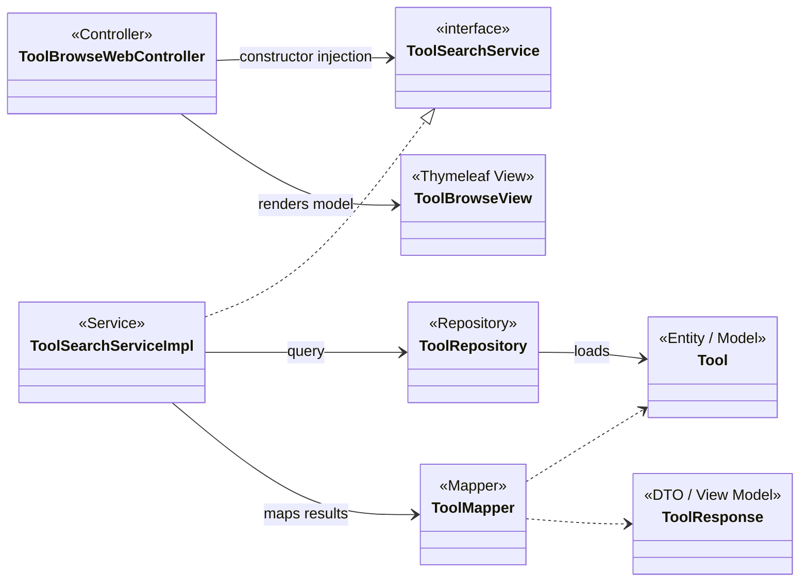

### Strategy

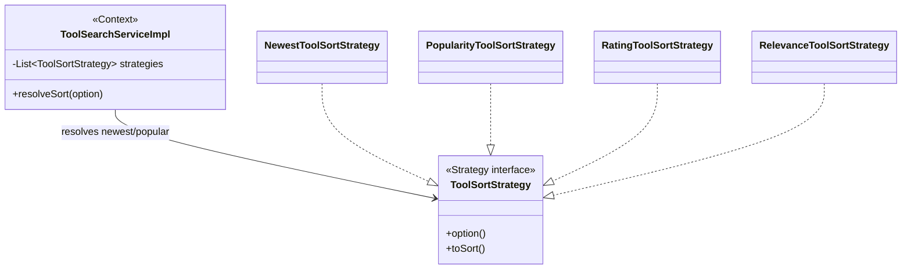

หมายเหตุ: ใน search flow ปัจจุบัน Strategy ถูกใช้จริงกับ newest/popular; rating/relevance เป็น strategy components ที่มีอยู่ แต่ ordering ของ query ทำใน service/repository แยกต่างหาก.

### State

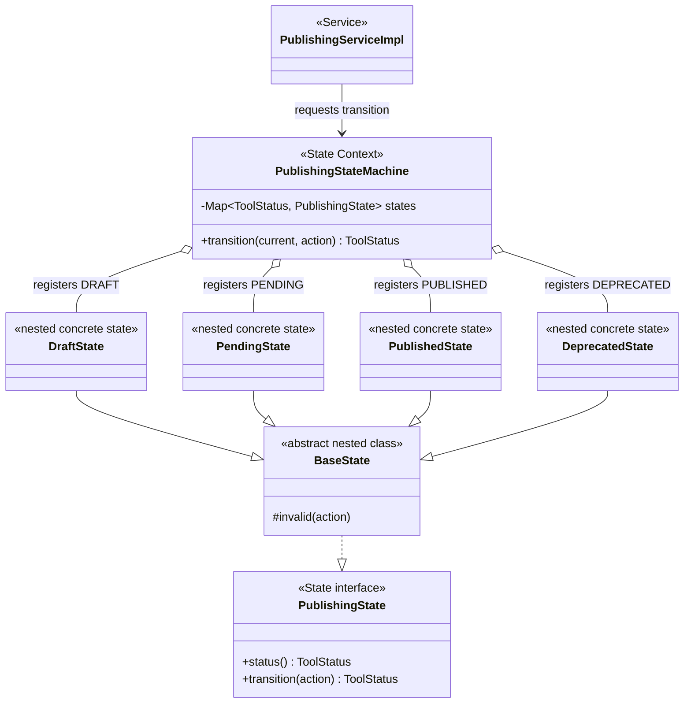

### Observer

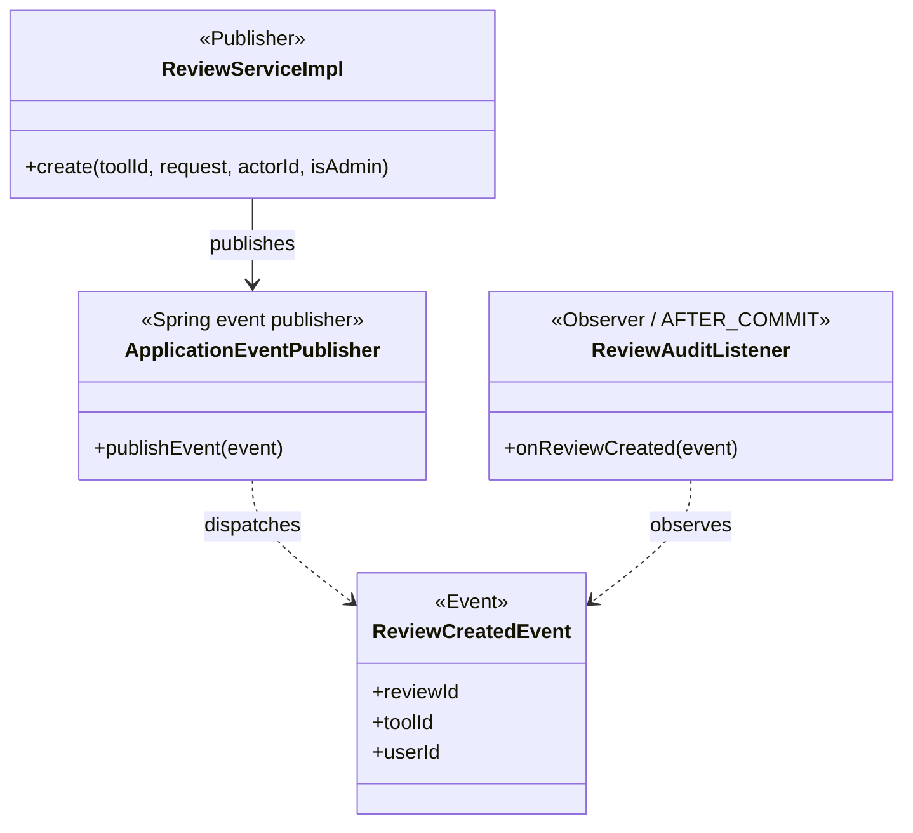

`ReviewAuditListener` รับ event ผ่าน Spring หลัง transaction commit; ถ้า transaction rollback จะไม่มีการบันทึก audit event. Listener ไม่ได้ถูกเรียกตรงจาก `ReviewServiceImpl`.

## 4. Sequence Diagrams

สาม scenario หลักยึดตามรายงาน ได้แก่ Browse/Search, Create Review และ Publish Tool; เพิ่ม Login เป็น sequence เสริมเพื่อแสดง session/CSRF.

### 4.1 (เพิ่มเติม) Login และสร้าง session

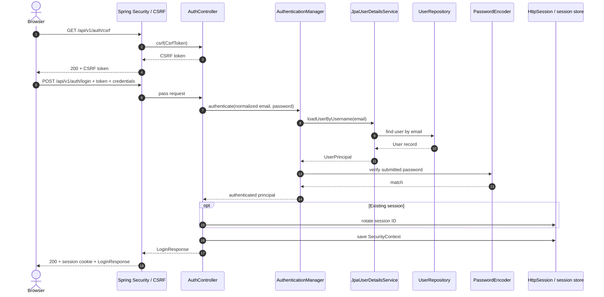

Logout invalidates the server session and clears the current `SecurityContext`. CSRF remains enabled for state-changing HTTP requests.

### 4.2 Browse, search, filter และ sort

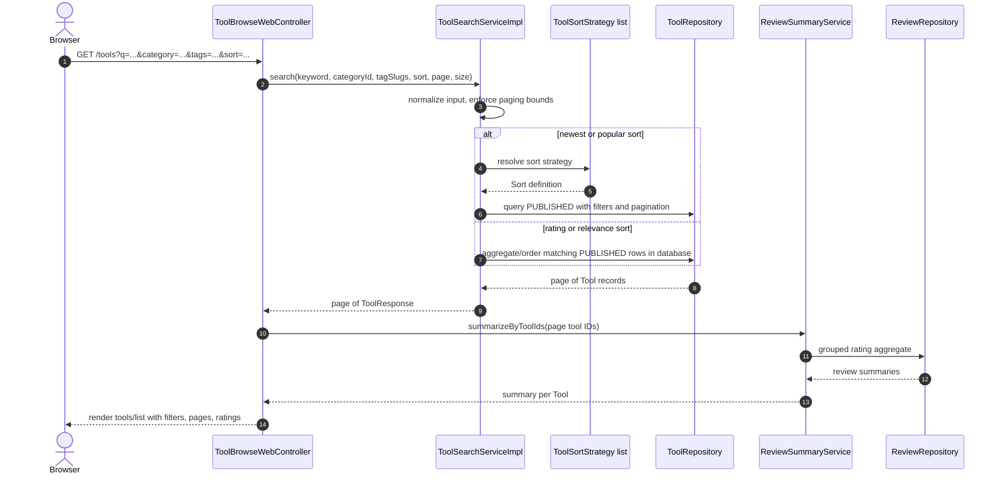

### 4.3 Sequence Diagram: Submit และพิจารณาการเผยแพร่

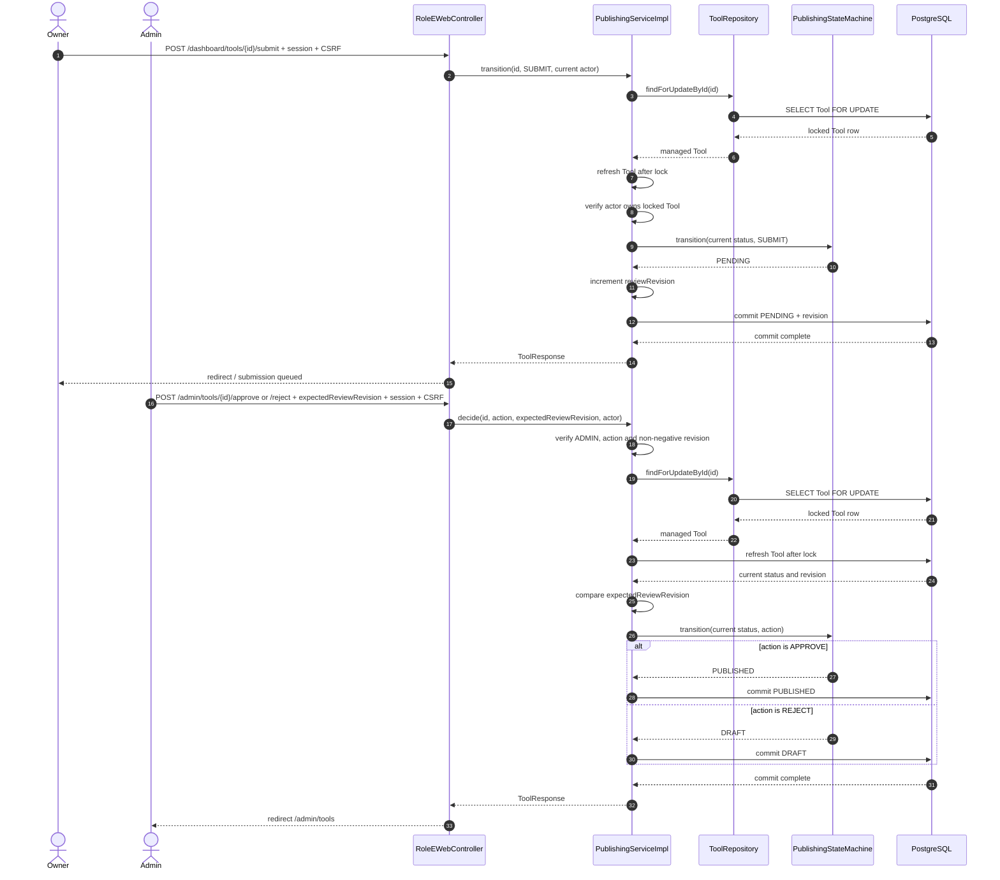

ถ้า revision ที่ส่งมาต่างจากค่าปัจจุบัน ระบบปฏิเสธคำตัดสินเก่า (stale decision) แทนการ approve ข้อมูลคนละ revision; State Machine ยังตรวจว่า Tool อยู่ `PENDING` และ action ถูกต้อง. หน้า Web ตรวจ session/CSRF ก่อนเรียก Controller; Controller ส่งผล Service กลับเป็น redirect.

หมายเหตุ: `RoleEWebController` ตรวจเจ้าของเบื้องต้นก่อนเรียก `PublishingServiceImpl`; service ตรวจเจ้าของซ้ำหลังล็อกและ refresh แถว Tool ก่อนเปลี่ยนสถานะ.

### 4.4 สร้างรีวิว Tool ที่เผยแพร่

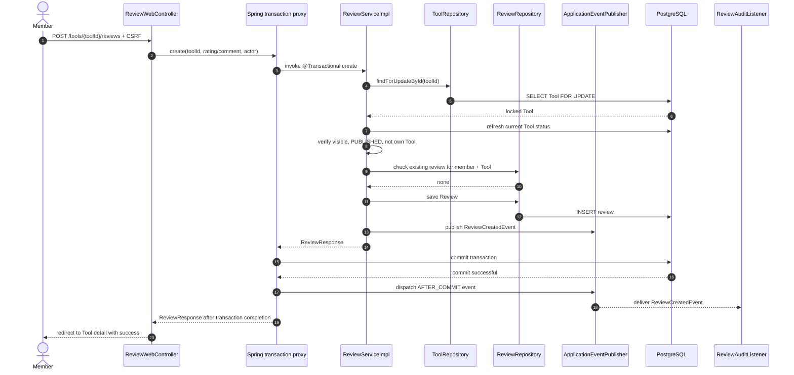

Listener ทำงานแบบ synchronous ใน AFTER_COMMIT callback ก่อนผล `create` กลับจาก transactional service proxy; ไม่ได้ dispatch เป็นงาน async และหาก transaction rollback จะไม่มีการเรียก listener. การตอบกลับ HTTP จึงไหลจาก Web Controller ไม่ได้มาจากฐานข้อมูลโดยตรง.

## 5. Activity Diagram

Flow การส่ง Tool เข้าตรวจและการพิจารณา โดยการตัดสินของ Admin เป็น request ใหม่หลังจาก submission commit แล้ว.

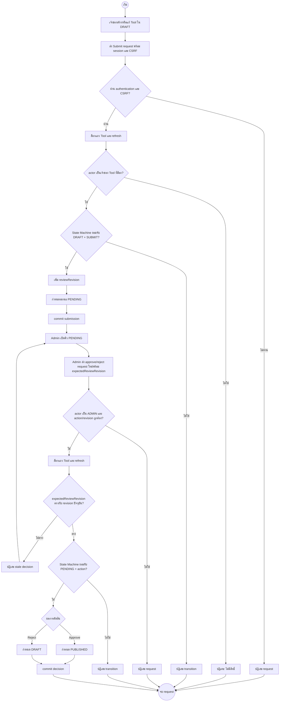

สิทธิ์/สถานะในแผนภาพเป็นลำดับตรวจใน service ที่ใช้แถว Tool ซึ่งล็อกและ refresh แล้ว; request ที่ตก guard จะไม่เปลี่ยนสถานะ. หลัง submission commit แล้ว การตัดสินของ Admin เป็น HTTP request/transaction แยก.

## 6. ER Diagram / Database Schema

ER source อ้างอิง `code/src/main/resources/schema.sql`; ชื่อคอลัมน์และข้อจำกัดใน SQL เป็นแหล่งจริงเมื่อมีความต่างกับภาพประกอบ.

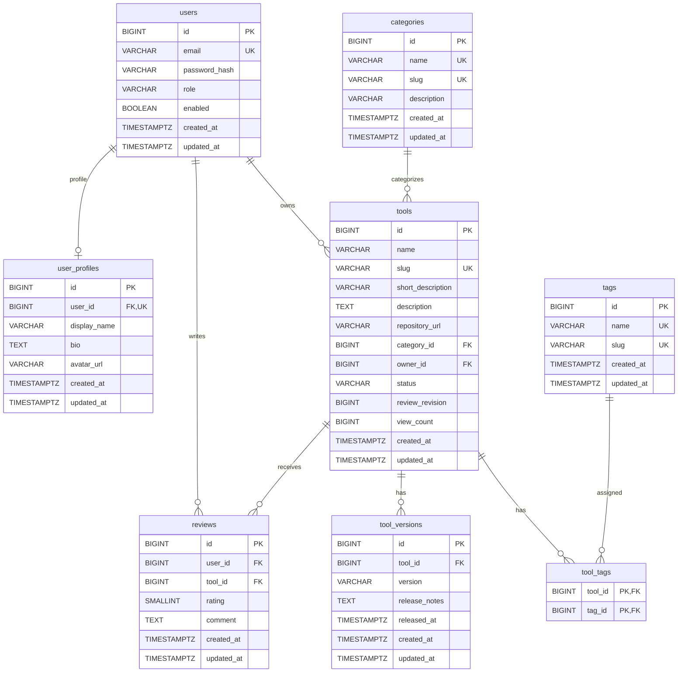

หมายเหตุ schema: `tool_tags` ใช้ composite primary key `(tool_id, tag_id)`; `user_profiles.user_id` unique; `reviews` unique `(user_id, tool_id)` และ `rating` อยู่ระหว่าง 1–5; `tool_versions` unique `(tool_id, version)`; `tools.review_revision >= 0`. FK ของ `tools.category_id` เป็น `ON DELETE RESTRICT`; FK ของ `user_profiles.user_id`, `tool_tags`, `reviews` และ `tool_versions` เป็น cascade; `tools.owner_id` ไม่มี cascade clause. เวลา `created_at`/`updated_at` เป็น `TIMESTAMP WITH TIME ZONE`. ภาพ PNG เป็นภาพย่อเพื่ออ่านง่ายและไม่ได้แทน DDL.

## 7. Component Diagram

แผนภาพยึด layer ตามรายงาน: Presentation → Service → Persistence → PostgreSQL โดยมี Security, DTO/Mapper, Validation, Error handling และ Events เป็น concerns ข้ามชั้น.

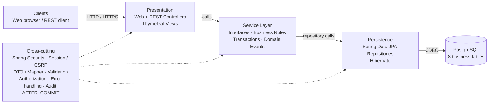

## 8. Deployment Diagram

แผนภาพยึด topology ในรายงาน: Browser เรียก Vercel runtime ผ่าน HTTPS; แอปใช้ Spring Session JDBC และเชื่อม PostgreSQL ที่ Supabase ผ่าน JDBC/TLS. ตาราง session เป็น infrastructure เพิ่มจาก 8 ตารางธุรกิจ จึงไม่อยู่ใน ER diagram ของ business schema ด้านบน.

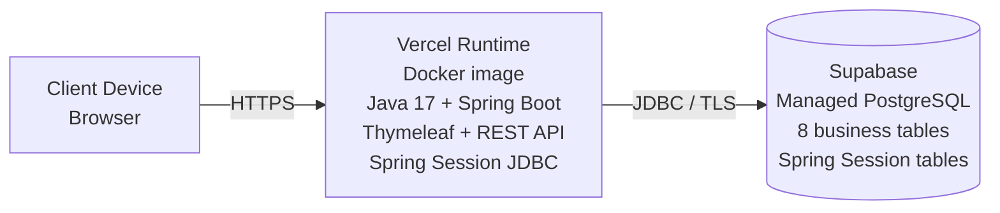

หมายเหตุ: แผนภาพนี้สรุป architecture ตามรายงานและ configuration ของ `Dockerfile.vercel`, profile `vercel` และ `JdbcSessionConfiguration`; มันไม่ได้ยืนยัน production acceptance ด้วยตัวเอง สถานะ project, schema rollout และ runtime URL ให้อ้างอิง [Vercel deployment runbook](../vercel-deployment-runbook.md). Local development ใช้ Docker Compose แยกจาก topology นี้.

## 9. State Diagram

`Tool.status` มีสถานะใน `ToolStatus`; transition ที่อนุญาตจริงอยู่ใน `PublishingStateMachine`.

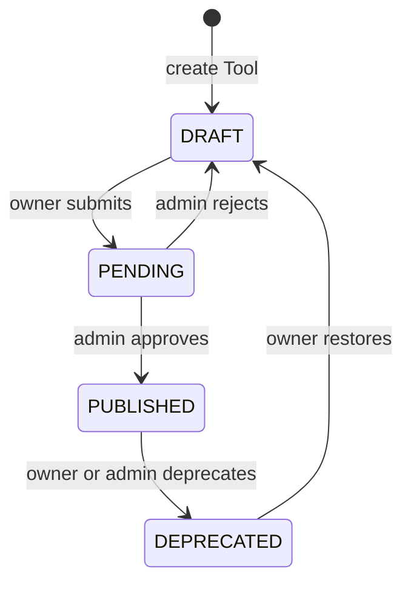

Transition อื่นนอกเหนือจากลูกศรเหล่านี้ถูกปฏิเสธด้วย `InvalidStateTransitionException`; Approve/Reject ยังต้องเป็น Admin และใช้ `expectedReviewRevision` ที่ตรงกับ submission ที่ตรวจ.
